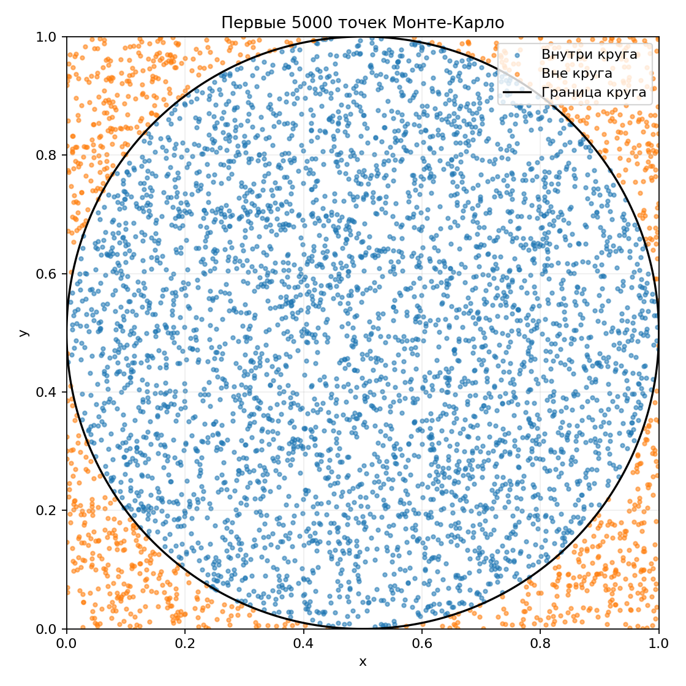
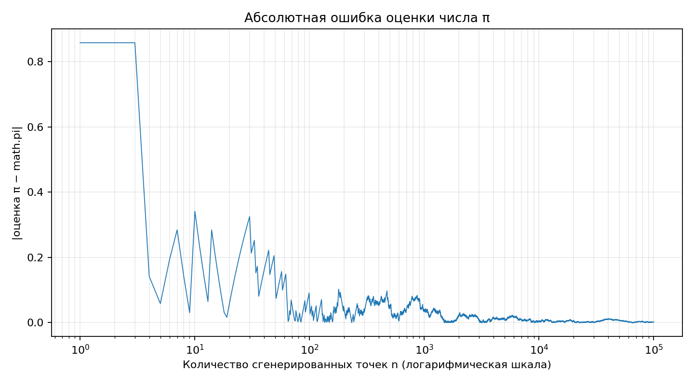

# Оценка числа π методом Монте-Карло

## 🎯 Цель работы

Смоделировать геометрическую вероятность попадания равномерно выбранной точки в круг и по этой вероятности получить приближённое значение числа π. Отдельная цель — проследить, как абсолютная ошибка меняется при увеличении числа точек.

---

## 📋 Точное задание

По материалу `lectures.pdf`, стр. 36–38, требуется:

1. Генерировать независимые координаты `x` и `y`, равномерно распределённые на `[0, 1]`.
2. Проверять попадание точки в круг, вписанный в единичный квадрат:

   ```text
   (x - 0.5)² + (y - 0.5)² <= 0.25
   ```

3. По доле попаданий оценивать число π.
4. Строить график абсолютной ошибки `|оценка π - math.pi|` в зависимости от числа использованных точек. Ошибка пересчитывается после добавления каждой новой точки.
5. Задать начальное состояние генератора случайных чисел один раз до начала генерации, чтобы результат можно было воспроизвести.

---

## 📚 Теория

Площадь единичного квадрата равна `1`. Радиус вписанного круга равен `0.5`, поэтому его площадь

```text
Sкруга = π · 0.5² = π / 4.
```

Следовательно, вероятность попадания равномерно выбранной точки в круг равна `π / 4`. Если среди `n` точек в круг попало `Hₙ`, то

```text
P(попадание) ≈ Hₙ / n,
π ≈ 4 · Hₙ / n.
```

После каждой новой точки программа сохраняет накопительную оценку

```text
π̂ₙ = 4 · Hₙ / n
```

и её абсолютную ошибку `|π̂ₙ - math.pi|`. Метод носит случайный характер: общая тенденция ошибки убывает, но на отдельных шагах она может увеличиваться.

---

## ⚙️ Выбор параметров

- `100000` точек дают достаточно устойчивую итоговую оценку и быстро обрабатываются на обычном компьютере.
- `seed=42` обеспечивает полную повторяемость опыта.
- Для облака точек показаны первые `5000` уже сгенерированных наблюдений. Дополнительные случайные числа для графика не генерируются.
- По горизонтальной оси графика ошибки используется логарифмическая шкала: на ней видны и сильные колебания в начале, и поведение оценки при больших `n`.
- В `checkpoints.csv` записаны первые десять шагов и контрольные точки `1`, `2`, `5` каждого десятичного порядка. Это сохраняет важную динамику без лишних 100000 строк.

---

## 🧮 Алгоритм

1. Один раз создать `random.Random(seed)`.
2. Для каждой из `n` точек получить два очередных числа генератора: `x` и `y`.
3. Проверить неравенство круга и при попадании увеличить счётчик `Hₙ`.
4. Рассчитать `π̂ₙ = 4 · Hₙ / n` и `|π̂ₙ - math.pi|`.
5. После завершения сохранить итог, контрольные значения и два графика.

---

## 📊 Результаты запуска

Результаты ниже получены для `100000` точек и `seed=42`.

| Количество точек `n` | Попаданий `Hₙ` | Оценка π | Абсолютная ошибка |
|---:|---:|---:|---:|
| 100 | 80 | 3.200000 | 0.058407 |
| 1 000 | 795 | 3.180000 | 0.038407 |
| 10 000 | 7 848 | 3.139200 | 0.002393 |
| 100 000 | 78 507 | **3.140280** | **0.001313** |

Итоговая относительная ошибка составляет около `0.0418%`. Неокруглённые результаты находятся в [summary.json](results/summary.json), а выбранные промежуточные значения — в [checkpoints.csv](results/checkpoints.csv).

### 🖼 Сгенерированные точки

Синим отмечены попадания в круг, оранжевым — точки за его пределами.



### 🖼 Зависимость абсолютной ошибки от числа точек

График построен по всем 100000 накопительным значениям ошибки. Он подтверждает ожидаемую тенденцию к уменьшению ошибки и показывает локальные колебания, о которых сказано в задании.



---

## ✅ Вывод

Метод Монте-Карло восстановил число π через отношение площадей: при 100000 точках получена оценка `3.140280` с абсолютной ошибкой `0.001313`. Эксперимент также показывает важное свойство случайного моделирования: увеличение выборки улучшает оценку в целом, но не гарантирует уменьшение ошибки на каждом отдельном шаге.

---

## 📁 Состав решения

- [pi_monte_carlo.py](pi_monte_carlo.py) — моделирование, сохранение результатов и построение графиков;
- [test_pi_monte_carlo.py](test_pi_monte_carlo.py) — тесты геометрии, накопительной оценки, проверки входа и воспроизводимости;
- `results/summary.json` — итог эксперимента;
- `results/checkpoints.csv` — компактная таблица контрольных значений;
- `results/point_cloud.png` и `results/absolute_error.png` — графики.

---

## 🚀 Запуск

Из корня репозитория:

```powershell
python -m pip install -r 01_Probability_Modeling/requirements.txt
python -X utf8 01_Probability_Modeling/01_Pi_Monte_Carlo/pi_monte_carlo.py
```

Параметры можно изменить:

```powershell
python -X utf8 01_Probability_Modeling/01_Pi_Monte_Carlo/pi_monte_carlo.py --points 50000 --seed 7
```

Флаг `--show` дополнительно открывает окна с графиками. Без него используется headless-режим Matplotlib, а изображения только сохраняются в `results/`.

Запуск тестов:

```powershell
python -X utf8 -m unittest discover -s 01_Probability_Modeling/01_Pi_Monte_Carlo -p "test_*.py" -v
```

Требуется Python 3.10 или новее и Matplotlib версии `>=3.7,<4`.
