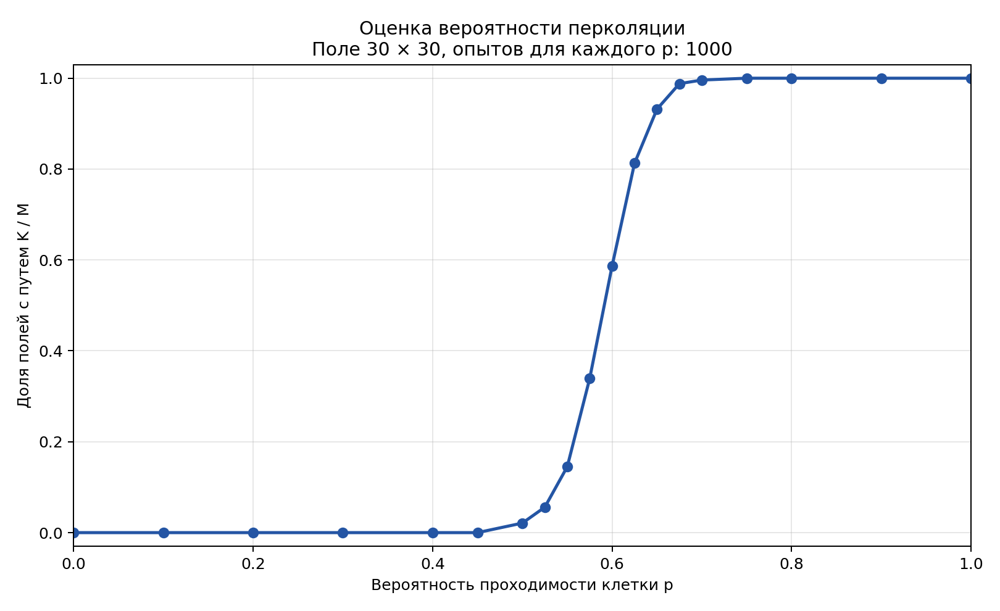
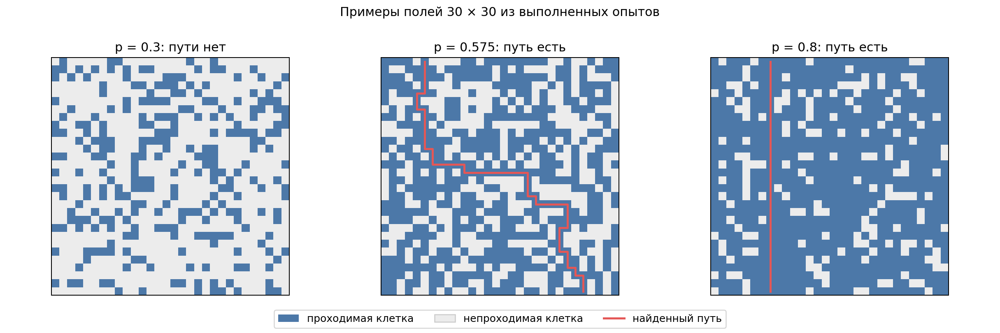

# 🌐 Практическое задание — вероятность перколяции

---

## 🎯 Цель работы

Методом Монте-Карло оценить вероятность того, что случайное прямоугольное клеточное поле имеет проходимый путь от верхней строки до нижней, и исследовать зависимость этой вероятности от параметра `p`.

---

## 📋 Условие задачи

Ниже реализовано задание со страниц 38–39 файла `lectures.pdf`.

Для каждого опыта создаётся новое прямоугольное поле. Каждая его клетка независимо от остальных:

- проходима с вероятностью `p`;
- непроходима с вероятностью `1 - p`.

Две клетки считаются соседними, только если у них есть общая сторона. Переходы по диагонали запрещены. Успешным считается опыт, в котором существует путь от любой проходимой клетки верхнего ряда до любой проходимой клетки нижнего ряда.

Если среди `M` опытов путь найден в `K` полях, вероятность перколяции оценивается частотой

```text
P̂(p) = K / M.
```

Для всех значений `p` используются одинаковые размеры поля. Обязательный результат — график зависимости оценки `P̂(p)` от `p`.

---

## 📚 Теория метода

Точное перечисление всех вариантов поля быстро становится непрактичным: поле `30 × 30` имеет `2^900` возможных конфигураций. Поэтому используется моделирование Монте-Карло:

1. Генерируется случайное поле для выбранного `p`.
2. Проверяется существование пути сверху вниз.
3. Опыт повторяется `M` раз на новых независимых полях.
4. Доля успешных опытов `K / M` служит оценкой искомой вероятности.

Фиксированный `seed` делает всю последовательность опытов воспроизводимой. Генератор `random.Random(seed)` создаётся один раз перед моделированием и затем последовательно используется для всех полей и всех значений `p`.

---

## 🔎 Поиск пути с помощью BFS

Для проверки поля применяется поиск в ширину — BFS (`breadth-first search`).

1. В очередь одновременно помещаются все проходимые клетки верхней строки.
2. Из каждой клетки рассматриваются четыре направления: вниз, вправо, вверх и влево.
3. Проходимая клетка добавляется в очередь только один раз.
4. Если BFS достигает нижней строки, перколяция существует.
5. Для каждой посещённой клетки запоминается предшественник, поэтому программа возвращает сам найденный путь для иллюстрации.

Для одного поля BFS требует не более `O(rows × cols)` операций и столько же дополнительной памяти.

---

## ⚙️ Параметры эксперимента

В полном запуске использованы:

- размер поля: `30 × 30`;
- число опытов для каждого `p`: `1000`;
- seed: `42`;
- значения `p`: `0; 0.1; 0.2; 0.3; 0.4; 0.45; 0.5; 0.525; 0.55; 0.575; 0.6; 0.625; 0.65; 0.675; 0.7; 0.75; 0.8; 0.9; 1`.

Плотная сетка значений в середине диапазона позволяет подробнее увидеть область, где оценка быстро меняется.

---

## 📊 Результаты моделирования

Ниже приведены фактические результаты запуска программы с параметрами по умолчанию.

| `p` | Успешных полей `K` | Опытов `M` | Оценка `K / M` |
|---:|---:|---:|---:|
| 0.000 | 0 | 1000 | 0.000 |
| 0.100 | 0 | 1000 | 0.000 |
| 0.200 | 0 | 1000 | 0.000 |
| 0.300 | 0 | 1000 | 0.000 |
| 0.400 | 0 | 1000 | 0.000 |
| 0.450 | 0 | 1000 | 0.000 |
| 0.500 | 21 | 1000 | 0.021 |
| 0.525 | 56 | 1000 | 0.056 |
| 0.550 | 145 | 1000 | 0.145 |
| 0.575 | 339 | 1000 | 0.339 |
| 0.600 | 587 | 1000 | 0.587 |
| 0.625 | 813 | 1000 | 0.813 |
| 0.650 | 932 | 1000 | 0.932 |
| 0.675 | 988 | 1000 | 0.988 |
| 0.700 | 996 | 1000 | 0.996 |
| 0.750 | 1000 | 1000 | 1.000 |
| 0.800 | 1000 | 1000 | 1.000 |
| 0.900 | 1000 | 1000 | 1.000 |
| 1.000 | 1000 | 1000 | 1.000 |

Полная таблица сохранена в [`results/percolation_results.csv`](results/percolation_results.csv), а параметры и значения — в [`results/summary.json`](results/summary.json).

---

## 📈 Графики

### Оценённая вероятность перколяции



Для данного конечного поля оценка близка к нулю при малых `p`, затем быстро возрастает в исследованной области примерно от `0.50` до `0.70` и становится близкой к единице. Это результат конечного моделирования, поэтому отдельные значения `K / M` зависят от размеров поля, числа опытов и seed.

### Примеры случайных полей



На рисунке показаны реальные поля, сохранённые во время численного эксперимента. Новые поля специально не генерировались после расчёта. Красная линия показывает путь, который восстановил BFS, если перколяция была обнаружена.

Для каждого `p` сохраняется первый успешный опыт, если такой встретился, иначе последний опыт серии. Поэтому эти изображения иллюстрируют возможную конфигурацию и найденный путь, но не частоту результата; частота рассчитана по всем `1000` опытам и приведена в таблице выше.

---

## 🧪 Проверки

Автоматические тесты проверяют:

- запрет диагональных переходов;
- старт из произвольной открытой клетки верхней строки;
- путь с боковыми переходами и обязательным движением вверх;
- поля из одной строки и одного столбца;
- точные результаты при `p = 0` и `p = 1`;
- прямоугольную форму поля;
- полную воспроизводимость при фиксированном seed.

---

## 🚀 Запуск

Из корня репозитория:

```bash
python -m pip install -r 01_Probability_Modeling/requirements.txt
python -X utf8 01_Probability_Modeling/02_Percolation/percolation.py
python -X utf8 -m unittest discover -s 01_Probability_Modeling/02_Percolation -p "test_*.py" -v
```

Параметры можно изменить через командную строку:

```bash
python -X utf8 01_Probability_Modeling/02_Percolation/percolation.py --rows 20 --cols 40 --trials 500 --seed 7
```

Флаг `--show` дополнительно открывает окна с графиками. Без него используется backend `Agg`, поэтому программа работает и без графического интерфейса. Файлы всегда сохраняются в папку `results/` рядом со скриптом.

---

## 📁 Структура решения

```text
02_Percolation/
├── percolation.py
├── test_percolation.py
├── README.md
└── results/
    ├── percolation_probability.png
    ├── field_examples.png
    ├── percolation_results.csv
    └── summary.json
```

---

## ✅ Вывод

Метод Монте-Карло позволил оценить вероятность существования пути через случайное клеточное поле. При выбранных параметрах оценка выросла с `0.339` при `p = 0.575` до `0.587` при `p = 0.600`, а при `p = 0.625` достигла `0.813`. Наблюдается быстрый переход между редко и часто перколирующими конечными полями, что хорошо видно на обязательном графике.

Условие о соседстве по общей стороне соблюдается BFS с четырьмя направлениями, а фиксированный seed обеспечивает точное повторение представленных чисел.
